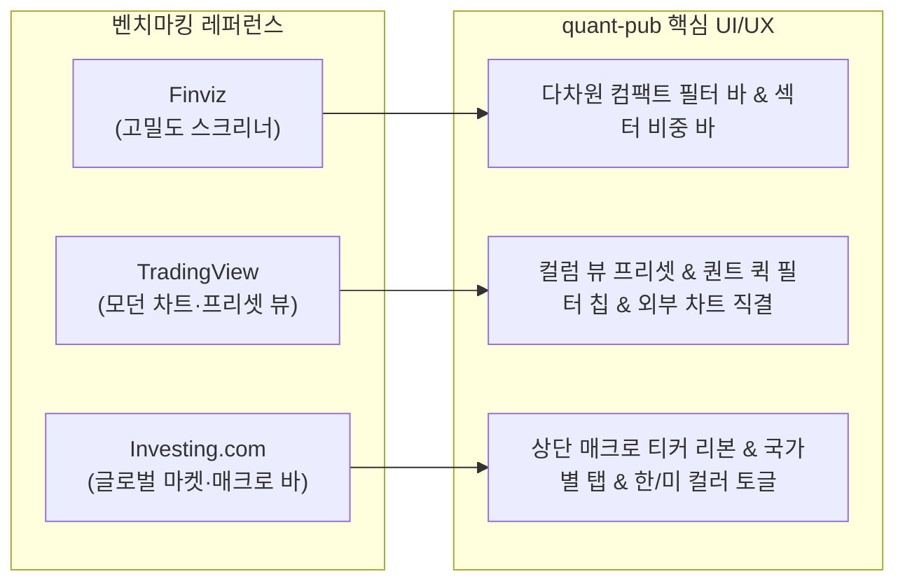
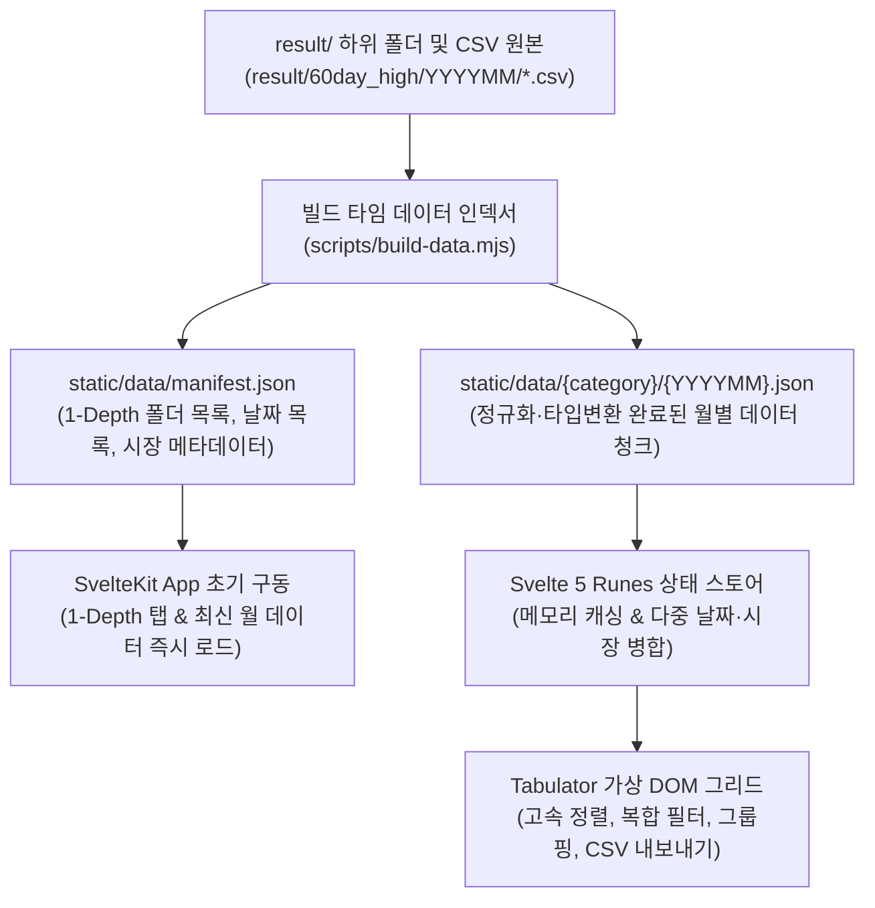

# 📊 글로벌 60일 신고가 퀀트 스크리너 (quant-pub) 구축 계획서

> **목표**: `result/` 하위 1-Depth 전략 폴더들을 동적 카테고리로 인식하고, 날짜별·국가별 60일 신고가 CSV 데이터를 통합하여 **Finviz · TradingView · Investing.com** 스타일의 고밀도 인터랙티브 **Tabulator** 그리드로 탐색·정렬·필터링할 수 있는 **SvelteKit (Svelte 5 Runes) 기반 GitHub Pages 정적 웹 애플리케이션**을 구축한다.

---

## 1. 기존 데이터셋(`result/`) 정밀 분석 결과

실제 워크스페이스(`result/`) 내 파일들을 전수 스캔한 결과, 설계 시 반드시 반영해야 할 핵심 데이터 특성은 다음과 같습니다.

### 1.1 폴더 계층 구조
```text
result/
 └── 60day_high/                 <-- 1-Depth 구분자 (향후 120day_high, volume_surge 등 확장 가능)
      ├── 202606/                <-- 월별 폴더 (YYYYMM)
      │    ├── 20260602_krx.csv
      │    ├── 20260602_macro.csv
      │    ├── 20260604_yf_sp500.csv
      │    └── ...
      ├── 202607/
      ├── 202608/
      ├── 202609/
      ├── 202610/
      └── 202611/
```

### 1.2 파일 유형 (총 11종 패턴)
| 구분 | 파일명 접미사 (`YYYYMMDD_*`) | 대상 시장 / 설명 | 비고 |
| :--- | :--- | :--- | :--- |
| **한국 주식** | `krx.csv` | 한국거래소 (`kospi`, `kosdaq`, `konex`) | 주력 KRX 데이터 (원화 기준) |
| **미국 S&P500** | `yf_sp500.csv` | 미국 S&P 500 (`s&p500`) | 달러(USD) 기준 |
| **미국 나스닥** | `yf_nasdaq.csv` | 미국 NASDAQ (`nasdaq`) | 달러(USD) 기준 |
| **중국 상해** | `yf_sse.csv` | 중국 상해증권거래소 (`sse`) | 위안(CNY) 기준 |
| **중국 심천** | `yf_szse.csv` | 중국 심천증권거래소 (`szse`) | 위안(CNY) 기준 |
| **일본 도쿄** | `yf_tse.csv` | 일본 도쿄증권거래소 (`tse`) | 엔(JPY) 기준 (종목 없는 날은 헤더만 존재) |
| **대만** | `yf_twse.csv` | 대만증권거래소 (`twse`) | 대만달러(TWD) 기준 |
| **베트남 호치민** | `yf_hose.csv` | 베트남 호치민거래소 (`hose`) | 동(VND) 기준 |
| **매크로 지표** | `macro.csv` | 환율·원자재·금리 등 거시지표 (`USDKRW=X` 등) | **별도 8컬럼 스키마** |
| **레거시(초기)** | `yf.csv`, `yf_krx.csv` | 2026년 6~7월 초기 수집 포맷 | 데이터 중복 방지를 위해 필터에서 기본 제외 옵션 제공 |

### 1.3 시기별 CSV 헤더 스키마 변천 (3단계 호환 필수)
데이터 수집 시점에 따라 주식 CSV 헤더가 **13컬럼 → 15컬럼 → 17컬럼**으로 진화했으므로, 파서(Parser)는 헤더 이름 기반으로 정규화해야 합니다.

1. **v1 (13컬럼 - 2026년 6월 초)**:
   `섹터A, 섹터B, 종목코드, 종목명, 시장구분, 기존최고가달성일, 기존최고가, 당일종가, 대비, 등락률, 종료일 거래량, 종료일 거래금액(백만원), 종료일 시가총액(억원)`
2. **v2 (15컬럼 - 2026년 6월 중순~)**:
   v1 + `당일최고가, 당일최저가` 추가
3. **v3 (17컬럼 - 2026년 10월~11월 최신)**:
   v2 + `3개월 종가 상승률, 1주 종가 상승률` 추가
4. **Macro 스키마 (8컬럼)**:
   `구분, 지표명, 티커, 기존최고가달성일, 기존최고가, 당일종가, 대비, 등락률`

### 1.4 데이터 정제(Cleaning) 및 퀀트 파생 컬럼 설계
Tabulator에서 정확한 숫자 정렬(Sorting)과 대소 비교 필터링(Filtering)을 수행하려면 원본 CSV 문자열을 그대로 넣지 않고 아래 규칙으로 변환해야 합니다.

- **천단위 콤마 문자열 → `Number` 변환**: `"190,400"` → `190400` (문자열로 두면 `"9,000"`이 `"10,000"`보다 크게 정렬되는 버그 발생)
- **부호·퍼센트 문자열 → `Float` 변환**: `"+32.03%"` → `32.03`, `"-0.53%"` → `-0.53`
- **`N/A` 및 결측치 처리**: `"N/A"` 또는 빈 문자열(`""`) → `null`로 변환 후 Tabulator 정렬 옵션 `alignEmptyValues: "bottom"`을 적용하여 오름차순·내림차순 모두에서 항상 최하단에 위치하도록 처리
- **자동 계산 파생 컬럼 (Derived Columns)**:
  1. **`recordDate` (기록일)**: 파일명(`20261106_...`)에서 추출한 `YYYY-MM-DD` (다중 날짜 통합 조회 시 필수)
  2. **`daysSincePrevHigh` (전고점 경과일)**: `기록일 - 기존최고가달성일` 일수 차이
     - *활용*: `1~3일`이면 **연속 신고가 모멘텀**, `30~60일+`이면 **장기 박스권 저항 돌파(첫 돌파)**로 즉시 필터링 가능
  3. **`breakoutPct` (돌파 강도 %)**: `(당일종가 - 기존최고가) / 기존최고가 * 100`
  4. **`appearCount` (기간 내 출현 횟수)**: 사용자가 다중 날짜(예: 최근 2주, 11월 전체)를 선택했을 때 해당 종목이 기간 내 60일 신고가에 등장한 총 횟수 (주도주 판별 핵심 지표)

---

## 2. 벤치마킹 사이트 UI/UX 핵심 요소 매핑



### 2.1 Finviz 스타일 요소
- **고밀도(High-Density) 멀티 필터 패널**: 불필요한 여백을 줄여 한 화면에 최대한 많은 종목(30~50개 행)이 들어오도록 컴팩트한 행 높이(`28px~32px`)와 상단 필터 그리드 구성.
- **스마트 수식 필터**: 숫자 컬럼 헤더 필터에 `>10` (10 이상), `<5` (5 이하), `10..50` (10~50 범위) 입력 시 즉시 파싱하여 필터링.
- **섹터/국가 분포 미니 바(Breakdown Bar)**: 현재 필터링된 종목들이 어느 국가·섹터에 집중되어 있는지 상단 요약 바에 비율로 시각화.

### 2.2 TradingView 스타일 요소
- **다크/라이트 금융 전용 테마**: 기본 다크 테마(`#131722` 배경, `#1e222d` 서피스, `#2a2e39` 보더) + 가독성 높은 라이트 테마 전환 지원.
- **고정폭 숫자 타이포그래피**: 모든 가격·등락률·거래량 셀에 `font-variant-numeric: tabular-nums` 적용하여 자릿수 흔들림 방지.
- **티커 뱃지 & 원클릭 차트 연동**: 종목 셀에 국가 국기 아이콘 + 시장 뱃지 표시, 클릭 시 **TradingView 차트**, **네이버 금융(KRX)**, **Yahoo Finance**로 바로 이동하는 퀵 액션 버튼 제공.
- **컬럼 프리셋 뷰 (Column View Tabs)**: 20여 개 컬럼을 목적별로 빠르게 전환하는 탭 제공
  - `[통합 전체]`, `[돌파·모멘텀 집중]`, `[가격·거래대금 집중]`, `[컴팩트 뷰]`
- **퀀트 원클릭 프리셋 칩 (Quick Filter Chips)**:
  - `🔥 연속 돌파 (전고점 경과 1~3일)`
  - `🚀 장기 저항 돌파 (전고점 경과 ≥ 30일)`
  - `📈 당일 급등 (등락률 ≥ +5%)`
  - `💎 슈퍼 모멘텀 (3개월 상승률 ≥ +50%)`
  - `👑 기간 내 다중 출현 주도주 (출현 ≥ 3회)`

### 2.3 Investing.com 스타일 요소
- **글로벌 마켓 탭 바**: `[전체 글로벌]`, `[🇰🇷 한국 KRX]`, `[🇺🇸 미국 S&P500]`, `[🇺🇸 미국 NASDAQ]`, `[🇨🇳 중국 SSE/SZSE]`, `[🇯🇵 일본 TSE]`, `[🇹🇼 대만 TWSE]`, `[🇻🇳 베트남 HOSE]` 탭과 각 시장별 신고가 종목 수 카운트 배지 실시간 표시.
- **상단 매크로 신고가 리본 (`macro.csv` 연동)**: 선택된 날짜(또는 기간)에 60일 신고가를 달성한 환율·지표(예: `원/달러 환율 1,533.07 (+0.19%)`)를 상단 알림 바에 표시.
- **한/미 등락 컬러 스킴 토글**:
  - **KR 모드**: 상승 빨강(`#ef4444`) / 하락 파랑(`#3b82f6`)
  - **US 모드**: 상승 초록(`#22c55e`) / 하락 빨강(`#ef4444`)

---

## 3. 시스템 아키텍처 및 정적 데이터 파이프라인

GitHub Pages는 런타임 서버(Node.js `fs`)가 없으므로, **빌드 타임(Pre-build) 인덱싱 스크립트**가 `result/` 폴더를 스캔하여 최적화된 정적 JSON 번들을 생성하는 SSG(Static Site Generation) 아키텍처를 채택합니다.



### 3.1 왜 개별 CSV 직접 호출 대신 '빌드 타임 월별 JSON 청크'인가?
1. **1-Depth 폴더 자동 탐색**: 브라우저에서는 디렉터리 리스팅(`fs.readdir`)이 불가능하므로, 빌드 시점에 `result/` 하위 1-Depth 폴더들을 읽어 `manifest.json`에 등록합니다. 향후 `result/120day_high` 폴더만 추가하고 푸시하면 UI 상단 카테고리에 자동 반영됩니다.
2. **다중 날짜 통합 분석 속도 (네트워크 병목 제거)**: 사용자가 "10월~11월 전체 국가 신고가 종목 모아보기"를 선택했을 때, 300개의 개별 CSV 파일을 HTTP 요청하면 수 초가 걸리지만, 정규화된 `202610.json`, `202611.json` 2개 파일만 fetch하면 **0.1초 이내**에 1만 건 이상의 데이터를 Tabulator에 렌더링할 수 있습니다.
3. **클라이언트 메모리 캐싱**: 한 번 불러온 월별 데이터는 브라우저 메모리(`Map<string, StockRow[]>`)에 캐싱되어 날짜/필터 변경 시 네트워크 요청 없이 즉각 반응합니다.

---

## 4. Svelte 5 Runes 상태 설계 및 컴포넌트 구조

### 4.1 디렉터리 구조 (`quant-pub`)
```text
d:\dev\business\quant-pub\
├── result/                          # [기존] 날짜별·국가별 CSV 원본 데이터
├── scripts/
│   └── build-data.mjs               # result/ 스캔 -> static/data/ JSON 생성 스크립트
├── static/
│   ├── .nojekyll                    # GitHub Pages Jekyll 비활성화
│   └── data/                        # [빌드 생성] manifest.json 및 월별 JSON 청크
├── src/
│   ├── app.html
│   ├── app.css                      # TailwindCSS / 커스텀 다크·라이트 테마 & Tabulator 오버라이드
│   ├── lib/
│   │   ├── types/
│   │   │   └── screener.ts          # StockRecord, MacroRecord, Manifest 타입 정의
│   │   ├── state/
│   │   │   └── screener.svelte.ts   # Svelte 5 Runes ($state, $derived) 핵심 상태 클래스
│   │   ├── utils/
│   │   │   ├── formatters.ts        # Tabulator 커스텀 포매터 (통화, 등락률 바, 티커 뱃지)
│   │   │   ├── sorters.ts           # 결측치(null) 하단 고정 정렬 및 커스텀 수식 필터 파서
│   │   │   └── links.ts             # 시장별 TradingView / 네이버금융 / Yahoo 차트 URL 생성기
│   │   └── components/
│   │       ├── HeaderNav.svelte     # 1-Depth 폴더 탭, 다크모드, KR/US 컬러 토글
│   │       ├── MacroRibbon.svelte   # macro.csv 기반 신고가 거시지표 티커 바
│   │       ├── FilterToolbar.svelte # 날짜(단일/기간/월), 시장 탭, 퀀트 프리셋 칩, 검색창
│   │       ├── SummaryBar.svelte    # 필터링된 종목 수, 국가/섹터 비중 미니 차트 바
│   │       ├── TabulatorGrid.svelte # Tabulator 메인 그리드 (가상스크롤, 그룹핑, 컬럼 프리셋)
│   │       └── StockDrawer.svelte   # 종목 클릭 시 신고가 이력 타임라인 & 미니 차트 드로어
│   └── routes/
│       ├── +layout.ts               # export const prerender = true; export const ssr = false;
│       ├── +layout.svelte
│       └── +page.svelte             # 메인 대시보드 페이지
├── .github/
│   └── workflows/
│       └── deploy.yml               # GitHub Pages 자동 빌드·배포 워크플로우
├── svelte.config.js                 # @sveltejs/adapter-static 및 base path 설정
├── vite.config.ts
└── package.json
```

### 4.2 Svelte 5 Runes 상태 스토어 설계 (`screener.svelte.ts`)
Svelte 4의 `writable/derived` 스토어 대신 **Svelte 5 Runes (`$state`, `$derived`, `$effect`)** 문법만 엄격하게 사용합니다.

- **핵심 Reactive State (`$state`)**:
  - `activeCategory = $state<string>('60day_high')` — 현재 선택된 `result/` 1-Depth 폴더
  - `dateFilterMode = $state<'single' | 'range' | 'month'>('single')` — 단일 날짜 / 기간 범위 / 월 전체
  - `selectedDate = $state<string>('')` — 단일 날짜 선택 값 (기본값: 가장 최신 날짜)
  - `dateRange = $state<{ start: string; end: string }>({ start: '', end: '' })` — 기간 조회 시작/종료일
  - `selectedMarkets = $state<Set<string>>(new Set(['all']))` — 선택된 국가/시장 필터
  - `includeLegacyYf = $state<boolean>(false)` — 6~7월 `yf.csv`, `yf_krx.csv` 포함 여부 토글
  - `activeQuickPreset = $state<string | null>(null)` — 퀀트 프리셋 칩 ID
  - `searchKeyword = $state<string>('')` — 종목명/티커/섹터 통합 검색어
  - `groupBy = $state<string | null>(null)` — Tabulator 그룹핑 기준 (`null`, `'market'`, `'sectorA'`, `'recordDate'`, `'code'`)
  - `columnPreset = $state<'all' | 'momentum' | 'price' | 'compact'>('all')` — 컬럼 표시 프리셋
  - `selectedStock = $state<StockRecord | null>(null)` — 우측 상세 히스토리 드로어 대상 종목

- **파생 데이터 (`$derived.by`)**:
  - `appearCountMap = $derived.by(...)`: 현재 선택된 날짜 범위 내에서 각 `market + code` 조합이 몇 번 등장했는지 실시간 해시맵 계산
  - `activeRows = $derived.by(...)`: 선택된 날짜(들), 시장, 검색어, 퀀트 프리셋 조건을 통과한 최종 행 배열 및 `appearCount` 주입
  - `marketCounts = $derived.by(...)`: 각 시장 탭 옆에 표시할 현재 날짜 기준 신고가 종목 수 집계
  - `sectorDistribution = $derived.by(...)`: 상단 요약 바에 표시할 상위 섹터 비중 집계

---

## 5. Tabulator 그리드 상세 설계 (`TabulatorGrid.svelte`)

### 5.1 컬럼 구성 및 정렬·필터 매트릭스
| 순서 | 필드명 (`field`) | 표시 헤더명 | 좌측고정 | 정렬 (`sorter`) | 헤더 필터 (`headerFilter`) | 표시 포맷 및 시각 효과 |
| :---: | :--- | :--- | :---: | :--- | :--- | :--- |
| 1 | `recordDate` | **기록일** | 📌 | `string` | 날짜 선택/입력 | `YYYY-MM-DD` (단일 날짜 모드에서는 숨김 가능) |
| 2 | `market` | **시장** | 📌 | `string` | 멀티셀렉트 드롭다운 | 국기 아이콘 + 시장 뱃지 (`KOSPI`, `NASDAQ` 등) |
| 3 | `code` | **종목코드** | 📌 | `alphanum` | 텍스트 검색 | 티커 뱃지 + 외부 차트 링크 아이콘 |
| 4 | `name` | **종목명** | 📌 | `string` | 텍스트 검색 | 굵은 텍스트, 클릭 시 종목 히스토리 드로어 오픈 |
| 5 | `appearCount` | **기간출현** | - | `number` | 수식 필터 (`>=2`) | `N회` 배지 (2회 이상 시 강조 컬러) |
| 6 | `sectorA` | **섹터A (대분류)** | - | `string` | 멀티셀렉트 드롭다운 | 텍스트 말줄임 + 툴팁 |
| 7 | `sectorB` | **섹터B (소분류)** | - | `string` | 텍스트 검색 | 산업코드(숫자)일 경우 업종 매핑 또는 서브텍스트 |
| 8 | `close` | **당일종가** | - | `number` | 수식 필터 (`>100`) | 시장별 소수점/정수 포맷 (`tabular-nums`) |
| 9 | `changePct` | **등락률(%)** | - | `number` | 수식 필터 (`>5`) | `+5.95%` 컬러 텍스트 + 셀 배경 미니 데이터 바 |
| 10 | `breakoutPct` | **돌파강도(%)** | - | `number` | 수식 필터 (`>2`) | 종가가 기존 최고가를 상회한 비율 (%) |
| 11 | `daysSincePrevHigh` | **전고점경과일** | - | `number` | 수식 필터 (`>=30`) | `1일 (연속)` vs `45일 (장기돌파)` 배지 |
| 12 | `prevHighDate` | **기존최고가일** | - | `string` | 텍스트 검색 | `YYYY-MM-DD` |
| 13 | `prevHigh` | **기존최고가** | - | `number` | 수식 필터 | 천단위 콤마 포맷 |
| 14 | `high` | **당일최고가** | - | `number` | 수식 필터 | 천단위 콤마 (`null` 시 `-`) |
| 15 | `low` | **당일최저가** | - | `number` | 수식 필터 | 천단위 콤마 (`null` 시 `-`) |
| 16 | `return1w` | **1주 상승률(%)** | - | `number` | 수식 필터 (`>10`) | 컬러 포맷 + 미니 히트맵 (`null` 하단 정렬) |
| 17 | `return3m` | **3개월 상승률(%)** | - | `number` | 수식 필터 (`>30`) | 컬러 포맷 + 미니 히트맵 (`null` 하단 정렬) |
| 18 | `volume` | **거래량** | - | `number` | 수식 필터 | 천단위 콤마 또는 `K/M` 축약 토글 |
| 19 | `tradingValue` | **거래대금(백만)** | - | `number` | 수식 필터 (`>1000`) | 천단위 콤마, 그룹 하단 합계/평균 산출 |
| 20 | `marketCap` | **시가총액(억)** | - | `number` | 수식 필터 | 천단위 콤마 (`N/A`는 정렬 시 항상 최하단 고정) |

### 5.2 Tabulator 핵심 인터랙션 디테일
1. **무중단 데이터 업데이트 (`replaceData`)**:
   - Svelte 5의 `$effect`에서 필터 변경 감지 시 `table.setData()` 대신 `table.replaceData(activeRows)`를 사용하여 사용자가 설정해둔 컬럼 정렬 순서와 가로 스크롤 위치가 초기화되지 않도록 유지합니다.
2. **결측치(`null` / `N/A`) 정렬 완벽 처리**:
   - 모든 수치형 컬럼에 `sorterParams: { alignEmptyValues: "bottom" }`을 적용하여 내림차순(`DESC`) 정렬 시에도 `N/A`가 맨 위에 뜨지 않고 항상 데이터 하단에 위치하도록 보장합니다.
3. **스마트 헤더 필터 (`customHeaderFilter`)**:
   - 수치형 헤더 필터 입력창에 사용자가 아래와 같이 입력할 수 있습니다:
     - `10` 또는 `>=10`: 10 이상
     - `>5`: 5 초과
     - `<=20`: 20 이하
     - `5..30` 또는 `5~30`: 5 이상 30 이하 범위
4. **다중 그룹핑 & 그룹 요약 (`groupBy` & `topCalc`)**:
   - `[그룹 없음]` / `[시장별]` / `[섹터A별]` / `[기록일별]` / `[종목별(다중 날짜 조회 시)]` 원클릭 전환
   - 각 그룹 헤더에 해당 그룹의 **종목 수**, **평균 등락률**, **평균 3개월 상승률**을 자동 표시.
5. **현재 필터 결과 내보내기 (Export)**:
   - 사용자가 정렬·필터링한 현재 뷰 상태 그대로 `CSV 다운로드` 및 `클립보드 복사` 버튼 제공.
6. **종목 상세 히스토리 드로어 (`StockDrawer.svelte`)**:
   - 그리드에서 특정 종목을 클릭하면 우측 슬라이드 패널이 열리며:
     1) 해당 종목이 전체 데이터 기간(6월~11월) 중 **60일 신고가를 기록한 모든 날짜의 타임라인과 당시 종가/등락률 추이** 표시
     2) **TradingView 임베드 차트** (지원 시장) 및 **네이버 금융 / Yahoo Finance / TradingView 새 창 열기** 버튼 제공

---

## 6. GitHub Pages 정적 배포 설계

### 6.1 SvelteKit 정적 어댑터 설정 (`svelte.config.js`)
- `@sveltejs/adapter-static` 사용 (`fallback: '404.html'`, `strict: true`)
- GitHub Pages 서브패스(`https://<user>.github.io/quant-pub/`) 호환을 위해 `paths.base`를 환경변수(`BASE_PATH`)와 연동하고, 모든 데이터 fetch 시 `$app/paths`의 `base`를 프리픽스로 사용 (`fetch(`${base}/data/manifest.json`)`).

### 6.2 GitHub Actions 자동 배포 워크플로우 (`.github/workflows/deploy.yml`)
- `main` 브랜치에 새로운 날짜의 CSV가 `result/` 폴더에 추가·푸시될 때마다 자동으로 실행:
  1. Node.js 22 환경 셋업 및 의존성 설치 (`npm ci`)
  2. `node scripts/build-data.mjs` 실행 (`result/` 전체 스캔 → `static/data/` JSON 생성)
  3. `BASE_PATH=/${{ github.event.repository.name }} npm run build` 실행
  4. `actions/upload-pages-artifact` 및 `actions/deploy-pages`를 통해 GitHub Pages 즉시 퍼블리싱

---

## 7. 단계별 구현 로드맵 (Implementation Phases)

### Phase 1: 프로젝트 초기화 및 데이터 빌드 파이프라인 구축
- [x] SvelteKit (Svelte 5) + TypeScript + TailwindCSS + `tabulator-tables` + `papaparse`(또는 자체 고속 CSV 파서) 환경 구성
- [x] `scripts/build-data.mjs` 작성:
  - [x] `result/` 하위 1-Depth 폴더 자동 탐색
  - [x] 13/15/17컬럼 주식 CSV 및 8컬럼 `macro.csv` 스키마 통합 정규화
  - [x] 숫자/퍼센트 파싱 및 파생 지표(`daysSincePrevHigh`, `breakoutPct`) 계산
  - [x] `static/data/manifest.json` 및 `static/data/<category>/<YYYYMM>.json` 생성 검증

### Phase 2: Svelte 5 Runes 상태 스토어 및 데이터 로더 구현
- [x] `src/lib/types/screener.ts` 인터페이스 정의
- [x] `src/lib/state/screener.svelte.ts`에 `$state`, `$derived.by` 기반 반응형 스토어 및 월별 JSON 온디맨드 캐시 로더 구현
- [ ] URL 쿼리 파라미터(`?category=60day_high&date=2026-11-06&market=krx`) 양방향 동기화(공유 링크 지원) 구현

### Phase 3: 상단 네비게이션 · 매크로 리본 · Finviz/TradingView 스타일 필터 바 구현
- [x] `HeaderNav.svelte`: 1-Depth 폴더 동적 탭, 다크/라이트 테마 스위치, KR/US 등락 컬러 토글
- [x] `MacroRibbon.svelte`: 선택 기간 내 신고가 달성 매크로 지표(`macro.csv`) 배지 표시
- [x] `FilterToolbar.svelte`: 날짜 모드(단일일 달력/빠른 이전·다음 영업일 이동, 기간 범위, 월 전체), 국가별 탭(종목 수 배지 포함), 퀀트 프리셋 칩, 통합 검색어 입력창 구현
- [x] `SummaryBar.svelte`: 현재 필터링 결과 요약 통계(총 종목 수, 평균 등락률, 국가/섹터 분포 미니 바) 구현

### Phase 4: Tabulator 그리드 및 종목 히스토리 드로어 구현
- [x] `TabulatorGrid.svelte`:
  - [x] 커스텀 다크/라이트 금융 테마 CSS 스타일링 (`tabular-nums`, 컴팩트 셀 패딩, `tabulator_midnight.min.css` 임포트)
  - [x] 좌측 고정 컬럼, 다중 컬럼 정렬, 결측치(`null`) 하단 고정 정렬기 적용
  - [x] 스마트 수식 헤더 필터(`>10`, `5..20`) 및 멀티셀렉트 리스트 헤더 필터 연결
  - [x] 컬럼 프리셋 뷰 전환, 그룹핑(`시장/섹터/날짜/종목`), CSV 내보내기 연동
- [x] `StockDrawer.svelte`: 행 클릭 시 해당 종목의 전체 기간 신고가 달성 이력 타임라인 및 외부 차트(TradingView, 네이버 금융, Yahoo Finance) 연동

### Phase 5: GitHub Pages 정적 빌드 검증 및 워크플로우 설정
- [x] `svelte.config.js` `adapter-static` 및 `paths.base` 테스트 (`npm run build && npm run preview`)
- [x] `.github/workflows/deploy.yml` 작성 및 `.nojekyll` 확인
- [x] 대용량 다중 날짜(6월~11월 전체 통합 조회) 시 렌더링 및 필터링 성능 최종 점검
